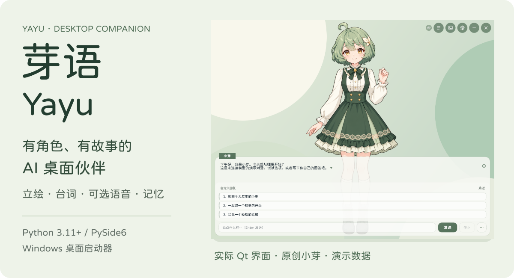
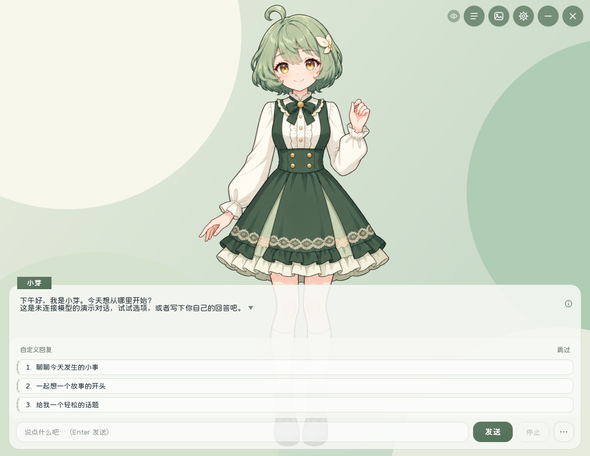
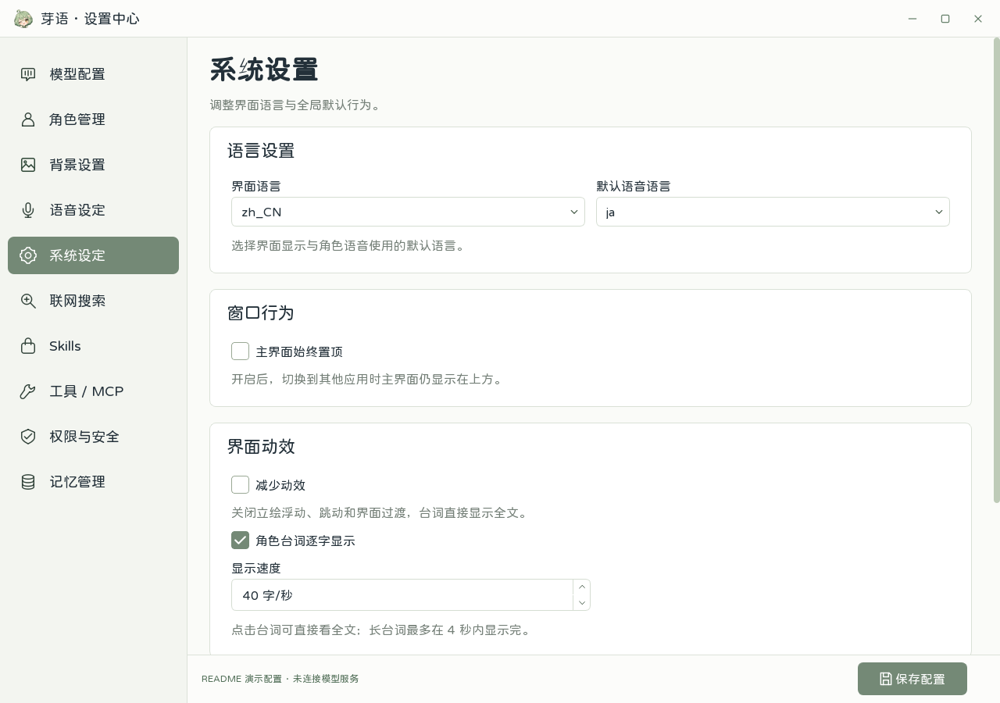

<p align="center">
  
</p>

# 芽语 · Yayu

**有角色、有故事的 AI 桌面伙伴。**

把大模型对话放进带立绘、台词框和剧情选项的桌面窗口，按需接入语音、记忆与工具。

内置默认角色 **小芽**——芽间书屋的故事整理员，温柔、机灵，也有自己的小坚持。配有完整人设和三张全身表情立绘，也可以在设置中换成自己的角色。[查看完整角色设定](data/characters/xiaoya/persona.md)。

[快速开始](#快速开始) · [日常使用](#日常使用) · [可选能力](#可选能力) · [开发与文档](#开发与文档) · [许可](#许可)



> 截图使用内置原创角色、自编台词与几何背景，未连接模型服务，也不包含真实聊天记录或本机服务配置。

## 让对话留在画面里

聊天界面围绕角色与对话展开：

- **让台词有画面。** 角色立绘、表情切换、逐字显示与点击反馈；点击台词可直接看全文。
- **想选就选，也能自己说。** 点击剧情选项、选择“自定义回复”，或点右上角“跳过”收起整组选项。
- **给每段故事留一份存档。** 创建、切换、重命名与管理会话；按会话选择 Skills，按角色或存档管理记忆。
- **让桌面按你的习惯工作。** 手动换背景，也可选择“无背景”；置顶默认关闭，减少动效与逐字速度可在系统设置调整。

<details>
<summary>查看设置界面</summary>



</details>

基于 **Python 3.11+ / PySide6**，支持角色与情绪立绘、逐段台词、流式回复、会话与剧情记忆、工具及 MCP。聊天与设置均为本地桌面窗口，模型回复需要你配置可访问的模型服务。

## 快速开始

Windows 用户可以从 [GitHub Releases](https://github.com/kuaileqiewuyou/yayu/releases/latest) 下载便携 ZIP，完整解压后双击 EXE，无需安装 Python。[便携版使用说明](docs/windows-portable.md)。以下步骤适用于源码运行。

以下以 **Python 3.11** 为例，在 **Windows PowerShell、项目根目录**运行。先创建虚拟环境并安装基础依赖；若使用其他受支持的 Python 版本，请相应调整版本参数：

```powershell
py -3.11 -m venv venv
.\venv\Scripts\python.exe -m pip install -r requirements.txt
.\venv\Scripts\python.exe scripts\init_config.py
```

初始化脚本只补齐缺失的配置，不覆盖已有内容。首次使用会加载带完整人设、三张透明全身立绘的“小芽”；已有角色配置会保留，明确删除并保存为空列表后也不会自动重新添加。

**1. 打开设置，配置模型。**

```powershell
.\venv\Scripts\python.exe webui_qt.py
```

在“模型配置”选择服务商，填写对应的 API 地址、Key 与模型名称，点击“保存配置”；在“角色管理”设置角色及立绘。支持 DeepSeek、OpenAI、Claude；其他 OpenAI 兼容接口请选择“自定义”，填写自己的 Base URL、API Key 和模型 ID。原生 Claude 需要额外安装 `anthropic`，见下方可选依赖。

**2. 打开聊天，发送第一句话。**

```powershell
.\venv\Scripts\python.exe main.py
```

TTS 与 CG 默认关闭，可以先完成纯文字对话，再按需开启。

**3. 可选：生成双击启动入口。**

```powershell
powershell -NoProfile -ExecutionPolicy Bypass -File scripts\build_windows_launcher.ps1 -DesktopShortcut
```

生成的 `Yayu.exe` 打开聊天，`Yayu Settings.exe` 打开设置。它们依赖当前项目与 `venv`，须留在项目根目录，不能单独当安装包复制使用。更新 Python 代码无需重建；移动项目后需更新快捷方式。

## 日常使用

**角色与立绘。** 在“角色管理”编辑设定、批量导入图片并绑定情绪，支持删除单张立绘与缩放预览。内置小芽包含“自然微笑”“开心眨眼”“安静倾听”三种动作；点击立绘有缩放回弹反馈。

**选择聊天角色。** 点击聊天框左上角的角色名，在列表中选择；也可以打开设置的“角色管理”，点击对应卡片的“使用此角色”。立绘和角色设定同步切换，每个角色保留自己的会话、聊天记录和记忆；切回来继续该角色最近的聊天。回复中请先点“停止”再切换。单独运行设置 EXE 时，选择保存在配置中，下次打开主界面生效。旧存档只有归属明确时才会关联角色，无法确认的记录保留原文件。

**背景与窗口。** 在“背景设置”导入、命名并手动选择背景，也可选“无背景”；聊天时点击顶栏的图片按钮切换。背景不由模型自动更换，背景音乐功能已移除。在“系统设置”调整逐字速度、减少动效或开启主界面置顶，置顶默认关闭。

**软件更新。** Windows 便携版可在“系统设置 → 软件更新”检查并安装新版：下载校验后自动备份，在原路径更新程序并重启，保留已有角色、配置、聊天与记忆。检查由你主动点击，启动时不会自动联网。私有仓库需要本机 GitHub 登录或一次性保存访问令牌；源码运行仅检查版本。[更新与备份说明](docs/windows-portable.md#检查与安装更新)。

**会话、记忆与 Skills。** 会话管理支持新建、切换、重命名、归档、删除、清空与重试。每个会话保留自己的 Skills 选择；修改全局默认不会覆盖旧会话。记忆可查看来源并手动确认、修改或删除，支持新剧情、继承角色长期记忆和接续存档。[查看记忆使用说明](docs/user-guides/memory.md)。

**停止当前回复。** “停止”会取消当前请求和待处理的语音、图片任务，保留已经显示的完整台词。已执行的工具操作不能撤销；取消本地 ComfyUI 等待也不会中断共享服务中已经开始的生成。

## 可选能力

| 想增加什么 | 配置与依赖 |
| --- | --- |
| Edge TTS 语音 | 额外安装 `edge-tts`；在“语音设定”选 `edge-tts`，无需填写 TTS 服务地址。 |
| GPT-SoVITS 语音 | 自行启动 GPT-SoVITS，配置服务地址与角色参考音频。 |
| ComfyUI 生成 CG | 自行启动 ComfyUI，配置地址和已安装的 checkpoint；生成图可在聊天区预览。 |
| 原生 Claude API | 额外安装 `anthropic`，再配置 Claude 的 API Key 与模型。 |
| MCP / 本地 Skills | 在“工具 / MCP”管理 MCP 接入，在“Skills”管理本地技能与组合。 |

```powershell
# 按需安装，不是首次文字聊天的必需步骤
.\venv\Scripts\python.exe -m pip install edge-tts
.\venv\Scripts\python.exe -m pip install anthropic
```

TTS 合成与播放失败不会阻断文字显示。修改模型、TTS 或 CG 配置后，重新打开聊天窗口使配置生效。ComfyUI 当前使用内置最小文生图工作流，不提供任意 workflow 导入；生成缓存位于 `data/cg/generated/`。[查看测试与离线预览](docs/testing.md)。

文件工具受授权目录约束；当前托管运行时的每条终端命令都需要人工批准，终端本身不受文件工具的目录沙箱限制。ASR / Vosk 与通用插件仍未接入主聊天流程。

## 配置与数据

API 配置由 `api.yaml` 默认值叠加 `api.local.yaml` 本机覆盖值。设置窗口默认把 API Key 与本机服务配置写入已被 Git 忽略的 `api.local.yaml`。

| 路径 | 内容 |
| --- | --- |
| `data/config/api.local.yaml` | 本机模型、TTS、CG 配置及 API Key |
| `data/config/characters.yaml` | 角色设定、情绪、立绘与参考音频 |
| `data/config/system_config.yaml` | 界面与默认 Skills 等系统设置 |
| `data/config/background.yaml` | 手动背景资源列表与名称；当前选择保存在系统设置 |
| `data/skills/` | 按 `SKILL.md` 组织的本地技能库 |
| `logs/` | Windows 启动器日志：`chat-*.log` / `settings-*.log` |

聊天历史与记忆保存在本机，但模型服务、Edge TTS 和搜索等功能可能访问网络。记忆后台整理会额外调用配置的模型并产生用量，详见[记忆说明](docs/user-guides/memory.md)。聊天记录、API Key 与本机日志不应随项目分享。仓库提供通用配置样例、内置原创角色和演示截图；运行时配置与个人导入资源应只保存在本机，提交前请检查文件清单。

## 开发与文档

Qt 输入经模型适配器和结构化消息解析，驱动台词、立绘、选项与资料卡；语音、CG 和工具作为可选流水线。运行时与界面分开组织：

```text
core/runtime/     应用启动、任务流水线与工具运行时
ui/               聊天窗口、设置中心与界面资源
llm/  tts/  t2i/   模型、语音与图像适配
config/           配置模型与本机覆盖
core/sessions/    聊天会话与存档
core/memory/      剧情记忆的存储、整理与检索
```

- [开发环境与测试](CONTRIBUTING.md)
- [角色与剧情记忆](docs/user-guides/memory.md)
- [立绘包与角色资源](docs/user-guides/sprite-pack.md)
- [角色模板与控制 token](docs/user-guides/character-template-control-tokens.md)
- [测试与离线预览](docs/testing.md)

早期设计与部分实现参考了 [Shinsekai](https://github.com/RachelForster/Shinsekai) 的 MIT 版本，后续持续重构和扩展。来源及许可见[第三方通知](THIRD_PARTY_NOTICES.md)。

## 许可

自 **1.0.5** 起，芽语有权授权的自有代码、文档和受版权保护的内置素材采用 [PolyForm Noncommercial 1.0.0](licenses/Yayu-Noncommercial.txt)：允许条款规定的非商业用途、修改和分发，条款未允许的商业用途需要另行授权。这是**源码可见、非商业授权**，不属于 OSI 开源许可；具体对象、例外和版本边界见[许可适用范围](licenses/Yayu-LICENSE-SCOPE.md)。源码仓库根目录的 `LICENSE` 提供相同条款。

第三方内容继续遵守各自原许可，包括早期 Shinsekai 的 MIT、字体的 SIL OFL 和 Qt 等依赖的 LGPL；项目许可不覆盖或削减这些权利。详见[第三方通知](THIRD_PARTY_NOTICES.md)。Windows 便携包在 `licenses/` 中提供项目许可全文、范围说明及第三方许可，不包含用户的密钥、私人配置或聊天记录。
